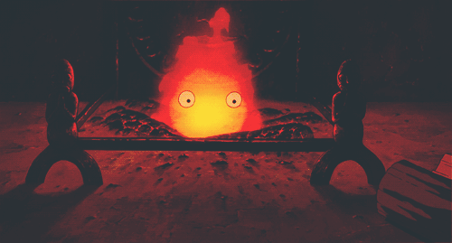

<div align="center">



</div>


---


<div align="center">

</div>

---

### I - About Me

```
⠀⠀⠀⠀⠀⠀⢀⣠⣤⣶⣶⡞⡀⣤⣬⣴⠀⠀⢳⣶⣶⣤⣄⡀⠀⠀⠀⠀⠀⠀   atlas@github
⠀⠀⠀⠀⣠⣾⣿⣿⣿⣿⡇⠀⢸⣿⠿⣿⡇⠀⠀⠸⣿⣿⣿⣿⣷⣦⡀⠀⠀⠀   ---------------------------------------------------------------
⠀⠀⢠⡾⣫⣿⣻⣿⣽⣿⡇⠀⠈⢿⣧⡝⠟⠀⠀⢸⣿⣿⣿⣿⣿⣟⢷⣄⠀⠀   name .......... Atlas
⠀⢠⣯⡾⢿⣿⣿⡿⣿⣿⣿⣆⣠⣶⣿⣿⣷⣄⣰⣿⣿⣿⣿⣿⣿⣿⢷⣽⣄⠀   age ........... 20yo
⢠⣿⢋⠴⠋⣽⠋⡸⢱⣯⡿⣿⠏⣡⣿⣽⡏⠹⣿⣿⣿⡎⢣⠙⢿⡙⠳⡙⢿⠄   role .......... Web Security Researcher & CS students
⣰⢣⣃⠀⠊⠀⠀⠁⠘⠏⠁⠁⠸⣶⣿⡿⢿⡄⠈⠀⠁⠃⠈⠂⠀⠑⠠⣈⡈⣧   focus ......... [bug-bounty, web-exploitation, networks, dev]
⡏⡘⠁⠀⠀⠀⠀⠀⠀⠀⠀⠀⠀⢀⡥⢄⢸⡇⠀⠀⠀⠀⠀⠀⠀⠀⠀⠈⢳⢸   learning ...... [pwn, reverse, AD]
⠇⠀⠀⠀⠀⠀⠀⠀⠀⠀⠀⠀⠀⠸⣄⣸⠟⠀⠀⠀⠀⠀⠀⠀⠀⠀⠀⠀⠈⢨   currently ..... hunting bugs, when they let themselves be found
⠀⠀⠀⠀⠀⠀⠀⠀⠀⠀⠀⠀⠀⠀⡴⠋⠀⠀⠀⠀⠀⠀⠀⠀⠀⠀⠀⠀⠀⠈   side_quest .... math, game dev, poker
⠀⠀⠀⠀⠀⠀⠀⠀⠀⠀⠀⠀⠀⠀⡳⣶⣄⡀⠀⠀⠀⠀⠀⠀⠀⠀⠀⠀⠀⠀   middle_name ... null  # no OSINT pls
```

### II - Languages & Tools

<div align="center">


</div>

<div align="center">


</div>

---

### III - CTF Stats

<!-- update manually: rank | points | challenges | compromissions | % per category -->

```
root-me@Atlas_py
------------------------------------------------
rank            #1233
points          5495
challenges      194 / 608  (31%)
compromissions  17

Web - Client    ██████████████████████░░░  90%
Web - Serveur   █████████████████████░░░░  84%
App - Script    ███████████░░░░░░░░░░░░░░  45%
Réseau          ██████████░░░░░░░░░░░░░░░  40%
Stéganographie  ███████░░░░░░░░░░░░░░░░░░  29%
Programmation   ██████░░░░░░░░░░░░░░░░░░░  24%
Réaliste        ██████░░░░░░░░░░░░░░░░░░░  24%
Cryptanalyse    ███░░░░░░░░░░░░░░░░░░░░░░  14%
App - Système   ░░░░░░░░░░░░░░░░░░░░░░░░░   3%
Cracking        ░░░░░░░░░░░░░░░░░░░░░░░░░   2%
Forensic        ░░░░░░░░░░░░░░░░░░░░░░░░░   0%
```
</div>

---

### IV - Repositories

<div>
<pre> <b>atlas@github</b>:~$ tree Qtlas/<br> Qtlas/<br> ├── <a href="https://github.com/Qtlas/Bug-Bounty-recon">Bug-Bounty-recon/</a>&nbsp;&nbsp;&nbsp;&nbsp;&nbsp;&nbsp;# recon workflow for bug bounty targets<br> ├── <a href="https://github.com/Qtlas/CTF">CTF/</a>&nbsp;&nbsp;&nbsp;&nbsp;&nbsp;&nbsp;&nbsp;&nbsp;&nbsp;&nbsp;&nbsp;&nbsp;&nbsp;&nbsp;&nbsp;&nbsp;&nbsp;&nbsp;&nbsp;# write-ups from challenges I solved<br> ├── <a href="https://github.com/Qtlas/side-projects">side-projects/</a>&nbsp;&nbsp;&nbsp;&nbsp;&nbsp;&nbsp;&nbsp;&nbsp;&nbsp;# school & personal projects, network & cyber<br> └── algo/<br> &nbsp;&nbsp;&nbsp;&nbsp;├── <a href="https://github.com/Qtlas/Leetcode_solutions">Leetcode_solutions/</a> # leetcode solutions<br> &nbsp;&nbsp;&nbsp;&nbsp;└── <a href="https://github.com/Qtlas/Exercism-backup">Exercism-backup/</a>&nbsp;&nbsp;&nbsp;&nbsp;# exercism solutions </pre>
</div>
---

### V - Github Stats

<div align="center">


</div>

---

### VI - Connect

<div align="center">

[](https://x.com/py_atlas)
[](https://www.root-me.org/Atlas_py)
[](https://app.hackthebox.com/users/1692433)

</div>

---
